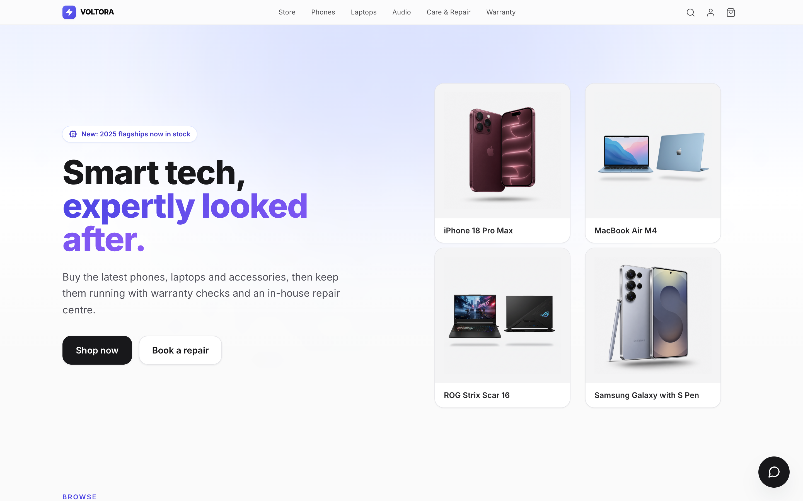
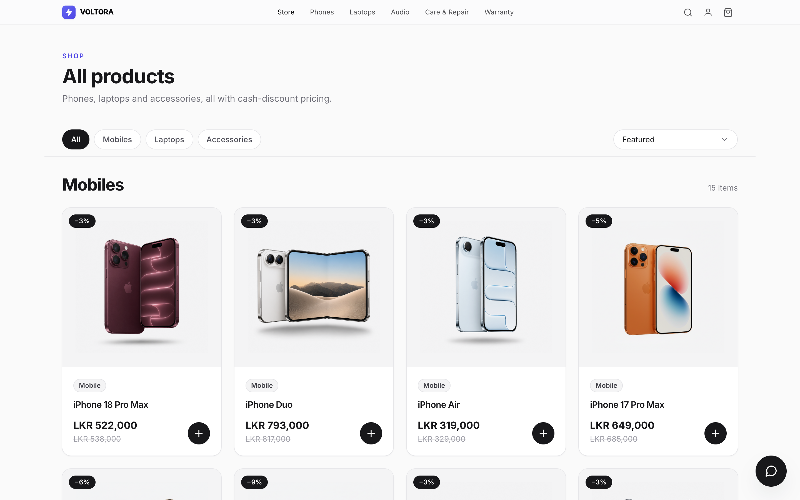
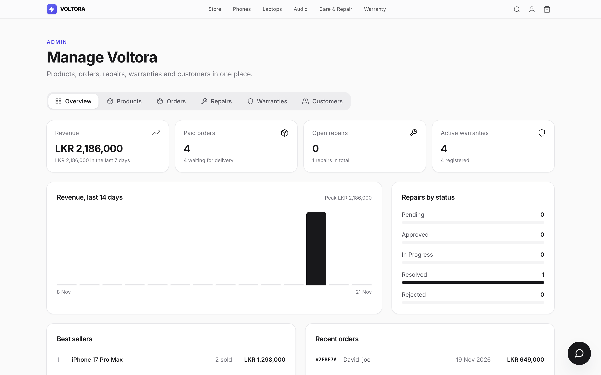
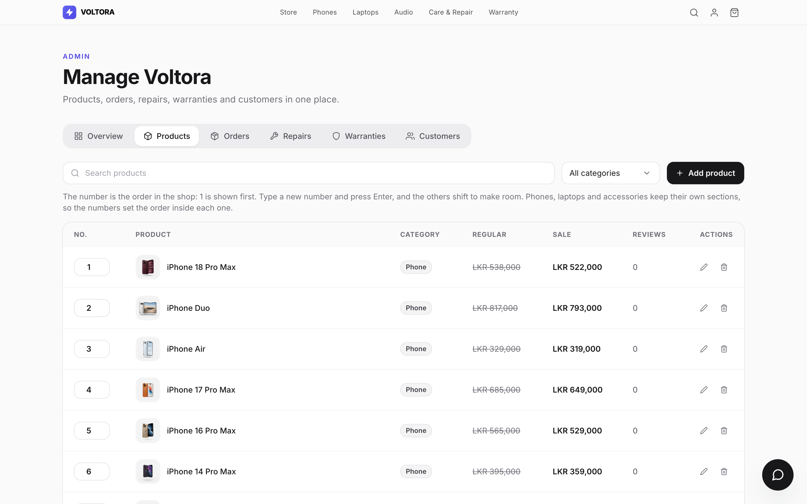
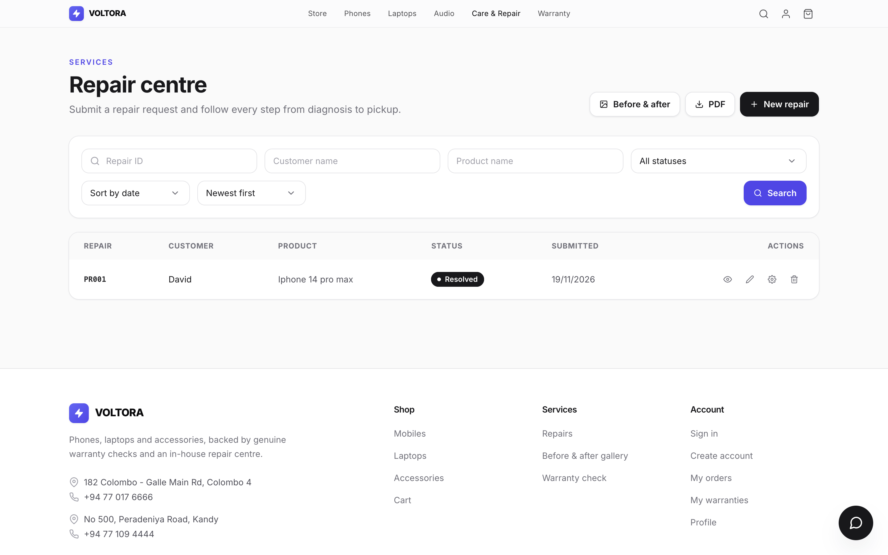
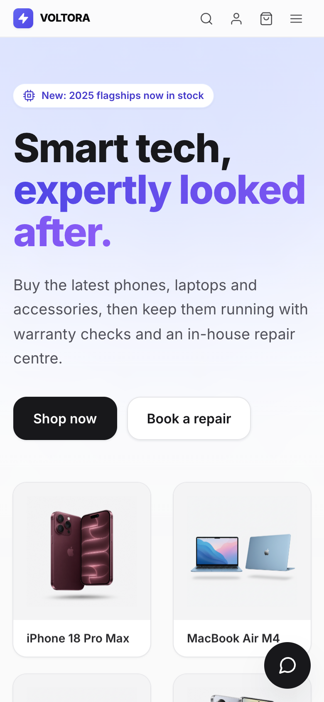
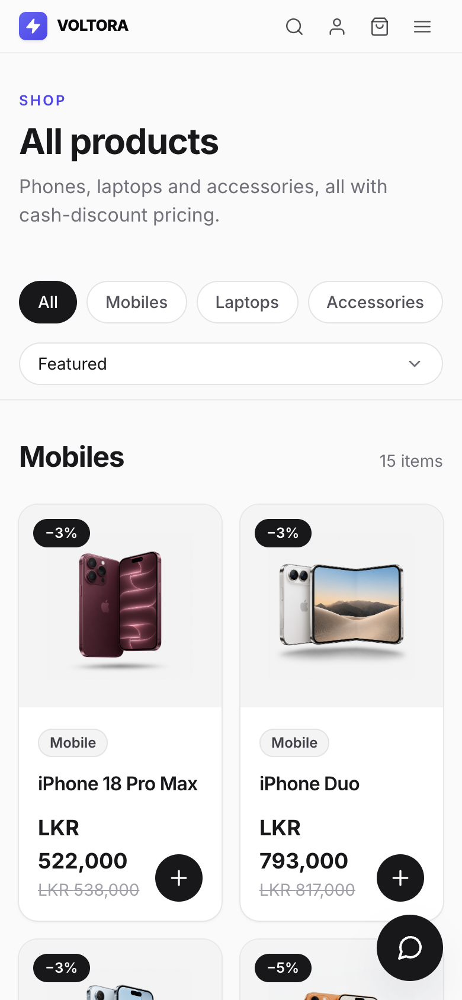

# Voltora

A full-stack store for phones, laptops and accessories, with built-in warranty checks and a repair centre. Customers can shop and pay online, track their repairs and look up warranties. Staff manage everything from an admin dashboard.

Built as a university project, and designed mobile first.



## Features

**Shop**
- Product catalogue with categories, search, sorting and sale prices
- Cart and checkout with Stripe (test mode)
- Order history and order details for each customer
- AI chat assistant for product questions

**Repair centre**
- Customers submit a repair with a photo of the damage
- Staff move each repair through Pending, Approved, In progress, Resolved or Rejected
- Before and after photo gallery, with full-size image preview
- Repair list with search, filters and PDF export

**Warranty**
- Look up a warranty by serial number, with days remaining
- Customers see their own registered devices, each with a QR code
- Staff register in-store sales

**Admin dashboard**
- Overview: revenue, paid orders, open repairs, a 14 day revenue chart, best sellers
- Products: add, edit and delete with image upload, and set the exact shop order by numbering products
- Orders: filter, view details, mark as delivered
- Repairs, warranties and customers: manage status, promote or remove users

**Accounts and security**
- Sign up, sign in and password reset by emailed code
- JWT authentication with customer and admin roles, enforced on the server
- Rate limiting, Helmet security headers, validated IDs and image-only uploads (5 MB max)

## Tech stack

| Layer | Tools |
| --- | --- |
| Frontend | React 19, Vite 7, Tailwind CSS 3, Redux Toolkit, React Router, Framer Motion, Axios |
| Backend | Node.js, Express 5, Mongoose, JWT, Multer, Nodemailer, Helmet |
| Database | MongoDB |
| Payments | Stripe Checkout |

## Screenshots

| Shop | Admin overview |
| --- | --- |
|  |  |

| Product management | Repair centre |
| --- | --- |
|  |  |

| Mobile home | Mobile shop |
| --- | --- |
|  |  |

## Project structure

```
backend/    Express API (routes, controllers, models, middleware, seed scripts)
frontend/   React app (pages, components, admin dashboard)
docs/       Screenshots
```

## Run it locally

You need Node.js 20 or newer and MongoDB.

**1. Start MongoDB** (Docker is the quickest way)
```
docker run -d --name voltora-mongo -p 27017:27017 mongo
```

**2. Backend**
```
cd backend
cp .env.example .env      # then edit .env (see below)
npm install
npm run seed              # sample products
npm start                 # http://localhost:5001
```

**3. Frontend**
```
cd frontend
cp .env.example .env
npm install
npm run dev               # http://localhost:5173
```

**4. Create an admin account**
```
cd backend
ADMIN_EMAIL=you@example.com ADMIN_PASSWORD='choose-a-strong-password' npm run seed:admin
```
Sign in at `/login` with the username `admin` and that password. If you promote an account that is already signed in, sign out and in again so the new role takes effect.

### Environment variables

Backend (`backend/.env`):

| Variable | Purpose |
| --- | --- |
| `MONGO_URI` | MongoDB connection string |
| `JWT_SECRET` | Long random string used to sign tokens |
| `CLIENT_URL` | Frontend address allowed to call the API |
| `STRIPE_SECRET_KEY` | Stripe test secret key (checkout reports a clear message without it) |
| `SMTP_*` | Email settings for reset codes (optional, codes print in the server console if empty) |

Frontend (`frontend/.env`): `VITE_API_URL`, `VITE_STRIPE_PUBLISABLE_KEY`, `VITE_GROQ_API_KEY`. Variables starting with `VITE_` are public in the built site, so only use test or low-risk keys there.

Never commit real `.env` files. They are git-ignored.

## API overview

| Area | Base path |
| --- | --- |
| Auth | `/api/auth` |
| Products | `/api/products` |
| Orders and checkout | `/api/orders`, `/api/stripe` |
| Repairs | `/api/repairs` |
| Warranties | `/api/warranty` |
| Admin (admin role only) | `/api/admin` |

## What I learned

- Designing role-based access that is enforced on the server, not just hidden in the UI
- Modelling a shop, a repair workflow and warranties in one MongoDB database
- Handling file uploads safely, and integrating Stripe Checkout
- Building a responsive, minimal interface that works well at phone width

## Author

[ShaknaRizath](https://github.com/ShaknaRizath)
